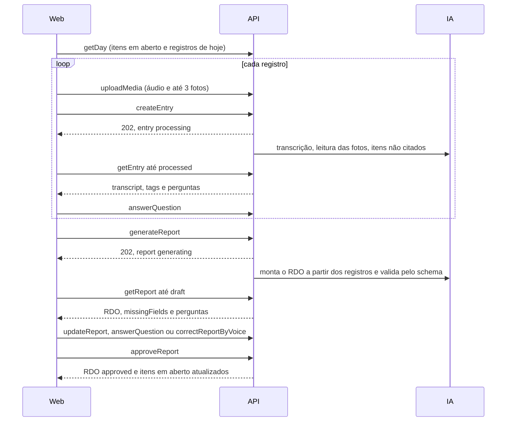

# RDO do dia

Situação: rascunho. Versão do contrato: 0.1.0.

## Objetivo

Do check-in ao RDO aprovado: os registros do dia viram um RDO, o agente pergunta o que faltou e cobra os itens em aberto, e o engenheiro aprova.

## Telas

`2.5`, `2.3`, `3.1`, `3.2`, `3.3`, `3.3b`, `3.7` e `3.4`.

## Sequência

## Regras

- O RDO do dia nasce no primeiro `generateReport` e é um só por obra e por dia. Um registro novo depois do rascunho entra quando a web chama `generateReport` de novo.
- O agente carrega os itens em aberto da obra no começo do dia (`F1RN07`) e, a cada registro, pergunta pelos que ainda não foram citados (`F1RN08`).
- A IA não preenche o que não ouviu nem viu (`RG05`). Cada lacuna em campo obrigatório vira uma pergunta e uma linha em `missingFields`.
- O serviço de cada atividade vem da planilha da obra. Quando a IA não acha um serviço com certeza, a atividade fica com `service` `null` e uma pergunta `service_match`.
- Indício de acidente no áudio torna a segurança obrigatória (`F1RN04`).
- `approveReport` só passa com `missingFields` vazio, no mínimo 3 fotos e, em obra pública ou financiada, uma foto por atividade e ocorrência (`RG06`, `F1RN02`).
- Na aprovação, a API grava `approvedBy` e `approvedAt` (`F1RN05`), aplica o desfecho de cada item que veio dos dias anteriores e abre os itens novos com `track` `true`. Só a partir daí eles entram na memória (`F1RN11`).

## Erros

| HTTP | `code` | Quando | O que a web faz |
|---|---|---|---|
| 409 | `SITE_NOT_IN_PROGRESS` | Registro numa obra que não está em andamento. | Leva à `2.10` pra voltar o status. |
| 409 | `PHOTO_LIMIT_ENTRY` | Mais de 3 fotos no registro. | Não deixa tirar a quarta foto. |
| 409 | `PHOTO_LIMIT_REPORT` | O dia passaria de 20 fotos. | Avisa o limite. |
| 409 | `PREVIOUS_DAY_PENDING` | Um dia anterior da obra ainda não tem RDO aprovado. | Leva à `2.6`. |
| 409 | `REPORT_INCOMPLETE` | Aprovar com campo obrigatório vazio. `errors` lista os campos. | Rola até o primeiro campo e marca os outros. |
| 409 | `REPORT_ALREADY_APPROVED` | Mexer num RDO aprovado. | Abre a `2.9`. |
| 200 | `entry.status` `failed` | A IA não conseguiu interpretar o registro. | Mostra que o registro foi salvo e oferece tentar de novo [❓A confirmar a operação de reprocessar]. |

## Idempotência

`uploadMedia` e `createEntry` usam o `id` gerado na web. `approveReport` usa `Idempotency-Key`: um toque duplo não aprova duas vezes. `generateReport` pode ser chamado várias vezes no mesmo dia e sempre remonta o mesmo rascunho.

## Casos de borda

- Fechar a web durante o `processing`: o registro já está na API, e a interpretação continua sem ela.
- Responder uma pergunta depois de o rascunho ser remontado: a pergunta pode ter sumido. A API responde 404 e a web recarrega o RDO.
- Editar a obra depois do rascunho: o rascunho guarda a cópia do dia até ser remontado.
