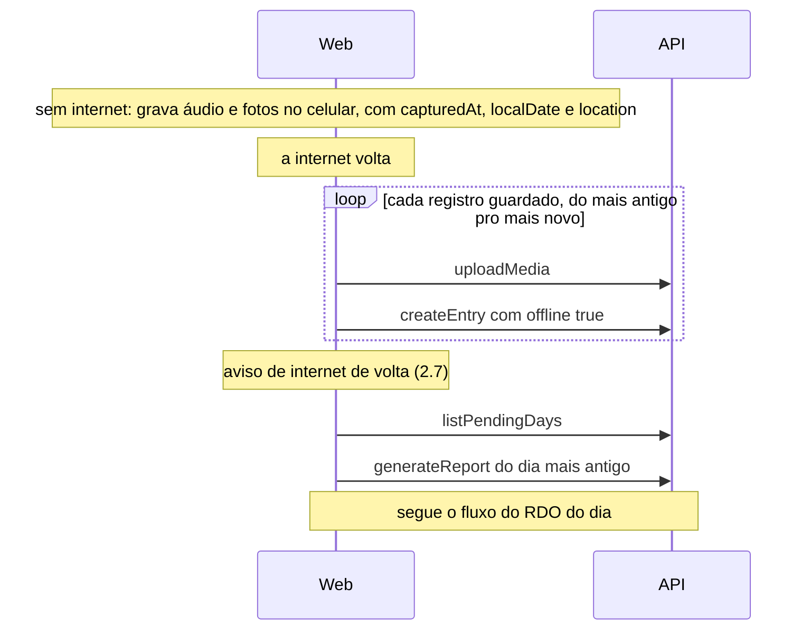

# Registro sem internet

Situação: rascunho. Versão do contrato: 0.1.0.

## Objetivo

Sem sinal no canteiro, o engenheiro grava áudio e fotos, e o RDO sai quando a internet volta, com a data da captura (`RG07`, funcionamento sem internet).

## Telas

`3.6`, `2.7`, `2.6` e, depois, as do [RDO do dia](rdo-do-dia.md).

## Sequência

## Regras

- Sem internet, a web não chama a API. Guarda áudio, fotos e os dados da captura no armazenamento do navegador.
- O envio começa sozinho quando a internet volta, enquanto a web estiver aberta [❓A confirmar o envio em segundo plano com a web fechada].
- O RDO sai com o `localDate` da captura, não com o dia do envio.
- Em cada obra, os dias são fechados do mais antigo pro mais novo ([D04]). `generateReport` de um dia responde 409 `PREVIOUS_DAY_PENDING` enquanto o anterior não estiver aprovado.
- As perguntas e a cobrança de itens em aberto acontecem na hora de montar o RDO de cada dia, porque o agente só conhece os itens aprovados até ali.

## Idempotência

Um envio que cai no meio é repetido inteiro. O mesmo `id` de mídia ou de registro devolve o que já foi gravado, com 200.

## Casos de borda

- O armazenamento do navegador foi limpo antes do envio: o registro se perde. A `3.6` avisa que o registro está só no celular.
- Dois dias guardados de obras diferentes: cada obra tem a própria fila.
- A obra foi concluída enquanto havia dias guardados: `createEntry` responde 409 `SITE_NOT_IN_PROGRESS`. Isso não deveria acontecer, porque concluir exige não ter RDO em aberto (`RG08`), mas a web avisa e mantém o registro no celular.

[D04]: ../../roadmap/ROADMAP.md#decisões-em-aberto
