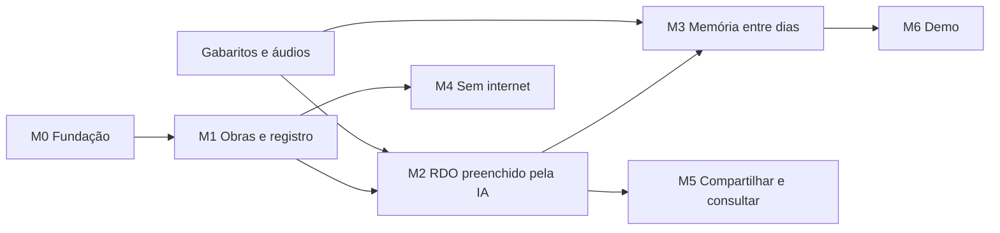

# Roadmap

Atualizado em 25/11/2026.

Cada marco termina com uma versão no ar, em staging, que alguém de fora do time consegue usar no celular. Os marcos andam em quatro raias: web (o app no navegador do celular), API, IA (o agente que preenche o RDO e lembra das pendências) e dados (a obra fictícia, os gabaritos e os áudios do eval). Responsáveis: [❓A definir quem fica em cada raia].

As regras de negócio ficam no [guia do time], que é a fonte da verdade. Este roadmap cita as regras pelo ID, como `F1RN08` (cobrança de pendências), e as telas pelo número do frame no [protótipo], como `3.2` (registro por voz). A ordem dos marcos pode mudar num PR, e os IDs continuam os mesmos.

## Visão geral

| Marco | Entrega | Situação |
|---|---|---|
| [M0](#m0-fundação) | Fundação | não iniciado |
| [M1](#m1-obras-e-registro) | Obras e registro | não iniciado |
| [M2](#m2-rdo-preenchido-pela-ia) | RDO preenchido pela IA | não iniciado |
| [M3](#m3-memória-entre-dias) | Memória entre dias | não iniciado |
| [M4](#m4-sem-internet) | Sem internet | não iniciado |
| [M5](#m5-compartilhar-e-consultar) | Compartilhar e consultar | não iniciado |
| [M6](#m6-demo) | Demo | não iniciado |

**Demo mínima:** de M0 a M3, mais o M6. É o que o [fluxo da demo] precisa: dois dias seguidos da mesma obra, com o agente cobrando no dia 2 o que ficou aberto no dia 1. O M4 e o M5 completam as 20 regras da primeira versão (`RG07`, sem internet, e `F1RN12`, compartilhamento).

O M4 depende só da captura do M1 e pode andar em paralelo ao M2 e ao M3. A raia de dados começa no M0, porque o eval do M2 precisa dos gabaritos prontos.

## Decisões tomadas

Decisões registradas no [guia do time], na tabela de decisões. Aqui fica só o que muda a construção.

| Tema | Decisão | Marco |
|---|---|---|
| Acesso (`RG01`) | Sem login na primeira versão. O engenheiro é o único perfil e entra direto no app. | M0 |
| Modelo de IA | Sem modelo local. Sem internet, o app só captura áudio e fotos, e o resto roda online (`RG07`). | M0 |
| Saída da IA (`RG06`) | O RDO sai em JSON validado contra o schema do formulário, sem campo obrigatório vazio. | M2 |
| Campos por tipo de obra (`RG02`) | Em obra pública ou financiada, os campos dessa categoria aparecem e são obrigatórios. Em obra privada, não aparecem. | M1, M2 |
| Fotos (`F1RN01`, `F1RN02`) | No máximo 3 fotos por registro, no mínimo 3 e no máximo 20 por RDO. Cada foto guarda data, hora e localização. | M1 |
| Início do registro (`F1RN01`) | Dois caminhos: pelo check-in (`2.5`), declarando a obra, ou direto de dentro da obra, sem passar de novo pela `2.5`. | M1 |
| Status da obra (`RG08`) | Não iniciada, em andamento, paralisada e concluída. Só a obra em andamento aparece pra registrar, e a obra não é concluída com RDO em aberto. | M1 |
| Campo que a IA não sabe (`RG05`) | A IA pergunta. Vale também pro código da planilha ou EAP da atividade. | M2 |
| Aprovação (`F1RN05`) | Registra o responsável, a data e a hora. Assinatura digital fica no backlog. | M2 |
| Painel do gestor | Fica no backlog. A tela `4.1` saiu do protótipo. | |

## Decisões em aberto

Cada uma tem uma recomendação, que vale até o time decidir diferente. A coluna Bloqueia diz qual marco precisa da decisão antes de começar. Decisão tomada sai daqui e vai pro guia.

| ID | Tema | Recomendação | Bloqueia |
|---|---|---|---|
| D01 | Stack do monorepo: framework da web, da API, banco e hospedagem | Registrar num ADR em `docs/decisoes/` antes do M0. | M0 |
| D02 | Status de uma obra recém-cadastrada (`RG08`) | Nasce em andamento, pra não exigir um passo a mais antes do primeiro registro. | M1 |
| D03 | Dias até destacar um item antigo (`F1RN10`) | 4 dias, como no protótipo (`2.8`). | M3 |
| D04 | Ordem de vários dias capturados sem internet (`RG07`) | Em ordem cronológica, pela data da captura, liberando cada RDO só depois da aprovação do anterior, como no protótipo (`2.6`). | M4 |
| D05 | Formato e destinatários do compartilhamento (`F1RN12`) | PDF pelo compartilhamento nativo do celular, como no protótipo (`3.5`). | M5 |
| D06 | IA perguntar sobre o que aparece na foto e não foi falado | Fica fora. A conferência entre foto e relato fica só no pitch. | M2 |

## M0 Fundação

- **Monorepo:** estrutura das pastas da web, da API e do que é compartilhado; CI com tipos, lint, testes e build; deploy de staging.
- **Schema do RDO:** os campos da matriz do guia num schema só, usado pela API pra validar a saída da IA e pela web pra montar a revisão (`RG06`). Já separa os campos universais, os de obra pública ou financiada e os recomendados.
- **IA:** chave da API da Anthropic, uma chamada de ponta a ponta em staging e a observabilidade ligada, guardando prompt, saída e tokens de cada execução.
- **Dados:** a obra fictícia e os primeiros gabaritos de RDO, em dias seguidos, com pendências que passam de um dia pro outro.
- **Decisões antes do marco:** D01.

Pronto quando a web abre no celular, fala com a API de staging e uma chamada à IA aparece na observabilidade.

## M1 Obras e registro

- **Web:** início (`2.1`), cadastro de obra privada e pública (`2.2`, `2.2b`), pasta da obra (`2.3`), status da obra (`2.10`, `2.11`), check-in (`2.5`) e o registro com áudio e até 3 fotos (`3.2`, sem a parte da IA).
- **API:** obras com os dados de `RG02` e os documentos opcionais com tipo, status da obra (`RG08`), registros por obra e por dia (`RG03`), upload do áudio e das fotos com data, hora e localização (`F1RN02`).
- **Decisões antes do marco:** D02.

Pronto quando o engenheiro cadastra uma obra, faz o check-in e grava registros com fotos ao longo do dia, e tudo fica guardado na obra certa.

## M2 RDO preenchido pela IA

- **IA:** transcrição do áudio e leitura das fotos; preenchimento dos blocos do RDO (`F1RN03`); pergunta pelo que faltou em vez de inventar (`RG05`); segurança obrigatória quando o áudio indica acidente (`F1RN04`); prompt caching entre as interações da mesma sessão.
- **Web:** linha do dia (`3.1`), o que o agente entendeu em cada registro (`3.2`), revisão do RDO em obra privada e pública (`3.3`, `3.3b`), correção falando, segurança antes de aprovar (`3.7`) e RDO aprovado (`3.4`).
- **API:** montagem do RDO a partir dos registros do dia, validação pelo schema (`RG06`), aprovação com responsável, data e hora (`RG04`, `F1RN05`) e numeração sequencial do RDO.
- **Dados:** os áudios gravados a partir dos gabaritos, com ruído de obra e jargão real.
- **Eval:** % de campos corretos contra o gabarito, % dos campos faltantes que o agente perguntou e campos inventados, com meta zero.
- **Decisões antes do marco:** D06.

Pronto quando um dia de registros vira um RDO aprovado que passa no schema, e o eval roda sobre pelo menos 10 áudios.

## M3 Memória entre dias

- **IA:** itens em aberto a partir do RDO aprovado (`F1RN06`, `F1RN11`); carga dos itens no início do dia (`F1RN07`); cobrança do que o áudio não citou (`F1RN08`); proposta de desfecho de cada item (`F1RN09`).
- **Web:** "Ficou dos dias anteriores" no RDO de hoje (`3.1`), a pergunta do agente durante o registro (`3.2`), os itens em aberto na revisão (`3.3`) e a tela de pendências por obra (`2.8`), com destaque dos itens antigos (`F1RN10`).
- **API:** itens em aberto por obra, com origem, situação e histórico de desfecho, sempre confirmado pelo engenheiro.
- **Eval:** % das pendências do dia anterior que o agente cobrou.
- **Decisões antes do marco:** D03.

Pronto quando o RDO do dia 2 cobra as pendências do dia 1 e cada item sai fechado, mantido ou atualizado.

## M4 Sem internet

- **Web:** captura de áudio e fotos guardada no celular sem sinal (`3.6`), envio quando a internet volta, aviso de dias pra finalizar (`2.7`) e fila de dias anteriores (`2.6`).
- **API:** recebimento de registros com a data e a hora da captura, e RDO com a data da captura, não a do envio.
- **Decisões antes do marco:** D04.

Pronto quando um dia gravado em modo avião vira RDO depois que a internet volta, com a data certa.

## M5 Compartilhar e consultar

- **Web:** compartilhar o RDO (`3.5`, `F1RN12`), baixar o PDF e consultar um RDO aprovado (`2.9`).
- **API:** geração do PDF do RDO aprovado e lista dos RDOs aprovados por obra.
- **Decisões antes do marco:** D05.

Pronto quando o engenheiro manda o PDF de um RDO aprovado pelo celular e abre um RDO antigo da obra.

## M6 Demo

- **Roteiro:** os dois dias da mesma obra do [fluxo da demo], ensaiados de ponta a ponta em staging.
- **Eval completo:** 10 a 20 gabaritos, com as quatro métricas do guia e o resultado na apresentação.
- **Pitch:** diferencial da memória entre dias e a conta de ROI do guia.
- **Se sobrar tempo**, nesta ordem: conferência com o cronograma físico, conferência do clima com o INMET e RAG com os documentos da obra.

Pronto quando a demo roda duas vezes seguidas sem intervenção.

## Situação de cada entrega

A tabela de entregas de um marco nasce quando o marco começa, logo abaixo da descrição dele, com uma linha por entrega:

| Raia | Entrega | Situação | Onde |
|---|---|---|---|
| Web | Cadastro de obra (`2.2`, `2.2b`) | em andamento | #12 |

- **Entrega** é um item que o marco lista. A linha resume, e o detalhe fica na issue.
- **Onde** aponta pra issue ou pro PR, neste repositório.
- **Situação** é `a fazer`, `em andamento`, `em revisão` (PR aberto), `pronto` (PR mergeado e critério do marco passando) ou `bloqueado: <motivo>`.
- A situação do marco, na visão geral, é `não iniciado`, `em andamento` a partir da primeira entrega que começa e `pronto` quando todas as entregas estão prontas e o critério de pronto passa.
- Mudança que só altera a situação entra direto na `main`, num commit como `docs: atualiza a situação do M1`. Qualquer outra mudança no roadmap segue por PR.

[guia do time]: https://claude.ai/artifact/9VhpdMpFe4kdAbJKgfADDQ
[protótipo]: https://claude.ai/artifact/KQMparWerCU2mP2s7fQBjs
[fluxo da demo]: https://claude.ai/artifact/9VhpdMpFe4kdAbJKgfADDQ
