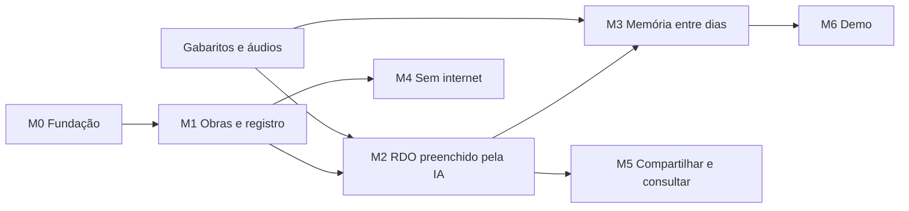

# Roadmap

Atualizado em 26/11/2026.

Cada marco termina com uma versão no ar, em staging, que alguém de fora do time consegue usar no celular. Os marcos andam em cinco raias: web (o app no navegador do celular), API, contrato, IA (o agente que preenche o RDO e lembra das pendências) e dados (a obra fictícia, os gabaritos e os áudios do eval). A web e a API andam separadas e se encontram no [contrato](../contratos/README.md): a web nunca espera a API, porque desenvolve contra um servidor falso gerado do contrato. Quatro devs dividem as raias em [frentes](#frentes).

As regras de negócio ficam no [guia do time], que é a fonte da verdade. Este roadmap cita as regras pelo ID, como `F1RN08` (cobrança de pendências), e as telas pelo número do frame no [protótipo], como `3.2` (registro por voz). A ordem dos marcos pode mudar, e os IDs continuam os mesmos.

## Visão geral

| Marco | Entrega | Situação |
|---|---|---|
| [M0](#m0-fundação) | Fundação | em andamento: falta o staging na EC2 |
| [M1](#m1-obras-e-registro) | Obras e registro | pronto |
| [M2](#m2-rdo-preenchido-pela-ia) | RDO preenchido pela IA | em andamento: faltam os áudios gravados, o eval sobre áudio e o prompt caching |
| [M3](#m3-memória-entre-dias) | Memória entre dias | em andamento: falta o eval da cobrança |
| [M4](#m4-sem-internet) | Sem internet | em revisão: falta conferir no celular em modo avião |
| [M5](#m5-compartilhar-e-consultar) | Compartilhar e consultar | em revisão: falta conferir o compartilhamento no celular |
| [M6](#m6-demo) | Demo | não iniciado |

A revisão final de 25/11/2026 achou 17 problemas no M1 ao M5 (concorrência, ordem dos dias, IA desligada, regeneração do RDO, recuperação depois de reinício, entre outros). Todos foram corrigidos em 26/11/2026 e conferidos pelos testes de ponta a ponta em [`scripts/e2e`](../../scripts/e2e/README.md), que rodam com a IA desligada ou com a IA falsa (`AI_FAKE`).

**Demo mínima:** de M0 a M3, mais o M6. É o que o [fluxo da demo] precisa: dois dias seguidos da mesma obra, com o agente cobrando no dia 2 o que ficou aberto no dia 1. O M4 e o M5 completam as 20 regras da primeira versão (`RG07`, sem internet, e `F1RN12`, compartilhamento).

O M4 depende só da captura do M1 e pode andar em paralelo ao M2 e ao M3. A raia de dados começa no M0, porque o eval do M2 precisa dos gabaritos prontos.

## Frentes

Quatro devs, cada um dono de uma frente e das pastas dela. As frentes seguem as raias, com duas exceções: o M4 sai da web e vai inteiro pra frente D, e o M5 vai inteiro pra frente A. A web é a raia mais pesada e fica só no caminho crítico, que é M1, M2 e M3. Contrato e dados andam um marco à frente, e a IA começa o M2 durante o M1, que não tem trabalho de IA.

| Frente | Responsável | Raias | Pastas |
|---|---|---|---|
| A Plataforma e API | [❓A definir: quem já está no M0] | API | `apps/api`, `infra/staging/` |
| B Web | [❓A definir] | Web | `apps/web` |
| C IA e eval | [❓A definir] | IA | `packages/agent` ([D19](../decisoes/0003-codigo-da-ia-em-packages-agent.md)) e o eval |
| D Contrato e dados | [❓A definir] | Contrato, dados e, a partir do M2, o M4 | `docs/contratos/openapi/`, `packages/contract`, `packages/rdo-schema`, `data/` |

| Marco | A Plataforma e API | B Web | C IA e eval | D Contrato e dados |
|---|---|---|---|---|
| M0 | Monorepo, CI, API base e staging. O esqueleto do monorepo sai primeiro, porque é a única entrega que bloqueia as outras. | Web PWA base contra o servidor falso, assim que `apps/web` existir. | Chamada à Claude com Langfuse e o teste da transcrição ([D17](../decisoes/0004-transcricao-do-audio-com-gemini.md)). | Convenções, OpenAPI do M1, servidor falso, schema do RDO, obra fictícia e 5 gabaritos. |
| M1 | Obras, registros e upload, já com o `id` idempotente da [escrita sem internet](../contratos/convencoes.md#escrita-sem-internet). | `2.1`, `2.2`, `2.2b`, `2.3`, `2.10`, `2.11`, `2.5` e `3.2` sem a IA. | O agente do M2 fora da API, contra os gabaritos, com o eval rodando. | Contrato do M2, os primeiros áudios gravados e as decisões do M2. |
| M2 | Montagem do RDO, operações demoradas, validação pelo schema, aprovação e numeração. | `3.1`, `3.2` com a IA, `3.3`, `3.3b`, `3.7` e `3.4`. | O agente em staging, com a pergunta pelo que faltou (`RG05`), a segurança quando há acidente (`F1RN04`) e o eval sobre 10 áudios. | Contrato do M3. Começa o M4: service worker, fila local e `3.6`. |
| M3 | Itens em aberto e o desfecho deles na aprovação. | A memória na `3.1`, na `3.2` e na `3.3`, e a `2.8`. | Carga, cobrança e desfecho dos itens em aberto, com o eval da cobrança. | O resto do M4: `2.7`, `2.6`, a fila de dias e o `listPendingDays` na API. |
| M5 e M6 | O M5 inteiro: PDF, lista de RDOs aprovados, `3.5` e `2.9`. | Acabamento e ensaio da demo. | Eval completo, de 10 a 20 gabaritos. | Roteiro da demo e os gabaritos que faltam. |

Se faltar tempo, o M4 é o primeiro a cair, porque a demo mínima não precisa dele. A frente D passa então a reforçar a web no M3, começando pela `2.8`.

Combinados entre as frentes:

- **IA fora do NestJS.** O agente fica num pacote com funções puras, como `interpretEntry` e `assembleReport`, que devolvem JSON validado pelo schema do RDO. A API cuida do 202, da fila e do banco. O eval roda direto no pacote, sem subir a API. Decidido na D19 ([ADR 0003](../decisoes/0003-codigo-da-ia-em-packages-agent.md)).
- **Um ponto só de envio do registro na web.** A `3.2` envia por um módulo da frente D, como `sendEntry`. No M1 ele manda direto pra API, e no M4 vira a fila local, sem reescrever a tela.
- **Schema do RDO com dono.** A frente D é dona do `packages/rdo-schema`. Mudança nele avisa as frentes A, B e C, porque quebra a web, a API e os gabaritos juntos ([ADR 0001](../decisoes/0001-stack-e-staging.md)).
- **Commit direto na `main` com quatro pessoas.** Commits pequenos, `git pull --rebase` antes de subir e CI verde. Tela incompleta fica fora da navegação até ficar pronta.

## Decisões tomadas

Decisões registradas no [guia do time], na tabela de decisões. Aqui fica só o que muda a construção.

| Tema | Decisão | Marco |
|---|---|---|
| Acesso (`RG01`) | Sem login na primeira versão. O engenheiro é o único perfil e entra direto no app. | M0 |
| Modelo de IA | Sem modelo local. Sem internet, o app só captura áudio e fotos, e o resto roda online (`RG07`). | M0 |
| Saída da IA (`RG06`) | O RDO sai em JSON validado contra o schema do formulário, sem campo obrigatório vazio. | M2 |
| Campos por tipo de obra (`RG02`) | Em obra pública ou financiada, os campos dessa categoria aparecem e são obrigatórios. Em obra privada, não aparecem. | M1, M2 |
| Fotos (`F1RN01`, `F1RN02`) | No máximo 3 fotos por registro, no mínimo 3 e no máximo 20 por RDO. Cada foto guarda data, hora e localização. | M1 |
| Início do registro (`F1RN01`) | Dois caminhos: pelo check-in (`2.5`), declarando a obra, ou direto de dentro da obra, sem passar de novo pela `2.5`. | M1 |
| Status da obra (`RG08`) | Não iniciada, em andamento, paralisada e concluída. Só a obra em andamento aparece pra registrar, e a obra não é concluída com RDO em aberto. | M1 |
| Campo que a IA não sabe (`RG05`) | A IA pergunta. Vale também pro código da planilha ou EAP da atividade. | M2 |
| Aprovação (`F1RN05`) | Registra o responsável, a data e a hora. Assinatura digital fica no backlog. | M2 |
| Painel do gestor | Fica no backlog. A tela `4.1` saiu do protótipo. | |
| Stack (D01) | Monorepo TypeScript com Next.js como PWA, NestJS, Postgres e Drizzle, staging numa EC2 com Docker Compose e fluxo trunk-based. Ver o [ADR 0001](../decisoes/0001-stack-e-staging.md). | M0 |
| Proteção da API (`RG01`, D07) | Uma chave por ambiente no cabeçalho `X-Api-Key`, que protege só de acesso casual. Login fica pra uma versão futura. Ver o [ADR 0002](../decisoes/0002-chave-da-api-sem-login.md). | M0 |
| Status da obra nova (D02, `RG08`) | A obra nasce em andamento. | M1 |
| Localização da obra (D09) | "Usar minha localização atual" manda a do celular. Sem ela, a API busca pelo endereço. | M1 |
| Foto da galeria (D10, `F1RN02`) | Só câmera, com e sem internet. A `3.6` não oferece a galeria. | M1 |
| Check-in (D12, `2.5`) | Não grava nada na API. É só a escolha da obra, e o primeiro registro abre o dia. | M1 |
| ART a renovar (D15, `2.1`) | Fica fora do início: não há regra nem campo de validade da ART. | M1 |
| Tempo de carro (D16, `2.1`) | O início mostra só a distância, sem serviço de rotas. | M1 |
| Número do RDO (D11) | O número sai na aprovação, sequencial por obra e sem saltos. A aprovação exige os dias anteriores da obra aprovados (D04), então o número segue a ordem das datas. | M2 |
| Transcrição do áudio (D17) | A API da Claude não recebe áudio; a API transcreve com o Gemini, com modelos de reserva em paralelo. Ver o [ADR 0004](../decisoes/0004-transcricao-do-audio-com-gemini.md). | M2 |
| Código da IA (D19) | Num pacote `packages/agent`, fora do NestJS, com funções puras que a API chama. Ver o [ADR 0003](../decisoes/0003-codigo-da-ia-em-packages-agent.md). | M1 |

## Decisões em aberto

Cada uma tem uma recomendação, que vale até o time decidir diferente. A coluna Bloqueia diz qual marco precisa da decisão antes de começar. Decisão tomada sai daqui e vai pro guia.

| ID | Tema | Recomendação | Bloqueia |
|---|---|---|---|
| D03 | Dias até destacar um item antigo (`F1RN10`) | 4 dias, como no protótipo (`2.8`). | M3 |
| D04 | Ordem de vários dias capturados sem internet (`RG07`) | Em ordem cronológica, pela data da captura, liberando cada RDO só depois da aprovação do anterior, como no protótipo (`2.6`). | M4 |
| D05 | Formato e destinatários do compartilhamento (`F1RN12`) | PDF pelo compartilhamento nativo do celular, como no protótipo (`3.5`). | M5 |
| D06 | IA perguntar sobre o que aparece na foto e não foi falado | Fica fora. A conferência entre foto e relato fica só no pitch. | M2 |
| D08 | Status do RDO: o guia fala em rascunho, enviado e aprovado | Só rascunho e aprovado. O protótipo não tem passo de envio, e "RDO enviado" no início (`2.1`) vira "RDO aprovado". | M2 |
| D13 | Interpretação ao vivo, durante a gravação (`3.2`) | Depois de salvar o registro. Ao vivo fica pra se sobrar tempo. | M2 |
| D14 | Aviso de internet de volta (`2.7`) | Notificação local da web depois do envio, sem push pela API. | M4 |
| D18 | Como o contrato fica `acordado` sem PR | O [README do contrato](../contratos/README.md) pede PR aprovado pela web e pela API, mas o fluxo é commit direto na `main`. A frente D sobe o contrato na `main`, as frentes A e B leem, e um commit muda a situação pra `acordado`. O README do contrato muda junto. | M1 |

## M0 Fundação

- **Monorepo:** estrutura das pastas da web, da API e do que é compartilhado; CI com tipos, lint e build, sem teste unitário ([ADR 0001](../decisoes/0001-stack-e-staging.md)); deploy de staging.
- **Schema do RDO:** os campos da matriz do guia num schema só, usado pela API pra validar a saída da IA e pela web pra montar a revisão (`RG06`). Já separa os campos universais, os de obra pública ou financiada e os recomendados.
- **IA:** chave da API da Anthropic, uma chamada de ponta a ponta em staging e a observabilidade ligada, guardando prompt, saída e tokens de cada execução; o teste da transcrição do áudio (D17).
- **Contrato:** [convenções](../contratos/convencoes.md) acordadas; OpenAPI do M1 escrito a partir das [telas](../contratos/telas/README.md) e das [operações](../contratos/operacoes.md); servidor falso pra web.
- **Dados:** a obra fictícia e os primeiros gabaritos de RDO, em dias seguidos, com pendências que passam de um dia pro outro.
- **Decisões antes do marco:** tomadas nos ADRs [0001](../decisoes/0001-stack-e-staging.md) (D01) e [0002](../decisoes/0002-chave-da-api-sem-login.md) (D07).

Pronto quando a web abre no celular, fala com a API de staging e uma chamada à IA aparece na observabilidade.

| Raia | Entrega | Situação | Onde |
|---|---|---|---|
| Contrato | Convenções e decisões do M1 | pronto | |
| Contrato | OpenAPI do M1 e servidor falso | pronto | |
| Web | Web PWA base | pronto | be838e2 |
| API | API base | pronto | 3e5e27a |
| IA | Chamada à Claude com Langfuse | pronto | 6641e3b |
| IA | Teste da transcrição do áudio (D17) | pronto: [ADR 0004](../decisoes/0004-transcricao-do-audio-com-gemini.md) | c41cd16 |
| Contrato | Schema do RDO | pronto | |
| Dados | Obra fictícia e 5 gabaritos | pronto | |
| API | Staging na EC2 | bloqueado: falta a EC2, o DNS e o `.env` | 9b46d2b |

## M1 Obras e registro

- **Web:** início (`2.1`), cadastro de obra privada e pública (`2.2`, `2.2b`), pasta da obra (`2.3`), status da obra (`2.10`, `2.11`), check-in (`2.5`) e o registro com áudio e até 3 fotos (`3.2`, sem a parte da IA).
- **API:** obras com os dados de `RG02` e os documentos opcionais com tipo, status da obra (`RG08`), registros por obra e por dia (`RG03`), upload do áudio e das fotos com data, hora e localização (`F1RN02`).
- **Contrato:** obras e registro acordados no OpenAPI.
- **Decisões antes do marco:** D02, D09, D10, D12, D15, D16 e D19 tomadas (tabela de decisões tomadas). Em aberto: D18.

Pronto quando o engenheiro cadastra uma obra, faz o check-in e grava registros com fotos ao longo do dia, e tudo fica guardado na obra certa.

| Raia | Entrega | Situação | Onde |
|---|---|---|---|
| API | Obras, status, equipamentos, documentos e planilha de serviços | pronto | 78f3719 |
| API | Upload de mídia, registros e dia (`uploadMedia`, `createEntry`, `getDay`) | pronto | 78f3719, 8ce49e0 |
| Web | Início, cadastro, pasta da obra, status, fora de andamento, check-in e registro | pronto | 83f8a62, 984589e, 4ac2f11, 7fe64a9 |
| Contrato | OpenAPI do M1 `acordado` (D18) | pronto | |

## M2 RDO preenchido pela IA

- **IA:** transcrição do áudio e leitura das fotos; preenchimento dos blocos do RDO (`F1RN03`); pergunta pelo que faltou em vez de inventar (`RG05`); segurança obrigatória quando o áudio indica acidente (`F1RN04`); prompt caching entre as interações da mesma sessão.
- **Web:** linha do dia (`3.1`), o que o agente entendeu em cada registro (`3.2`), revisão do RDO em obra privada e pública (`3.3`, `3.3b`), correção falando, segurança antes de aprovar (`3.7`) e RDO aprovado (`3.4`).
- **API:** montagem do RDO a partir dos registros do dia, validação pelo schema (`RG06`), aprovação com responsável, data e hora (`RG04`, `F1RN05`) e numeração sequencial do RDO.
- **Dados:** os áudios gravados a partir dos gabaritos, com ruído de obra e jargão real.
- **Eval:** % de campos corretos contra o gabarito, % dos campos faltantes que o agente perguntou e campos inventados, com meta zero.
- **Contrato:** RDO, perguntas e operações demoradas acordados no OpenAPI.
- **Decisões antes do marco:** D06, D08, D11, D13, D17.

Pronto quando um dia de registros vira um RDO aprovado que passa no schema, e o eval roda sobre pelo menos 10 áudios.

O número do RDO sai na aprovação (D11), não ao gerar.

| Raia | Entrega | Situação | Onde |
|---|---|---|---|
| Contrato | RDO, perguntas e operações demoradas no OpenAPI | pronto | 10c5346, 314812e |
| API | Montagem, validação pelo schema, correção à mão, aprovação e numeração | pronto | bd655df, fc4bc1d, b9bd519, 8ca533f |
| IA | Transcrição do áudio com Gemini (D17) | pronto | c41cd16, e571b18 |
| IA | Agente do RDO com pergunta pelo que faltou (`RG05`) e segurança no acidente (`F1RN04`), recalculando ao gerar de novo | pronto | 7cdf0b4, ba89b98, 5e84200, 3be1b13 |
| IA | Prompt caching entre as interações da mesma sessão | a fazer | |
| Web | `3.1`, `3.2` com a IA, `3.3`, `3.3b`, `3.7` e `3.4` | pronto | 9417f3c, d47cb7e, b8b0f3a, e999342, a301786 |
| Dados | Áudios gravados a partir dos gabaritos | a fazer | |
| IA | Eval sobre pelo menos 10 áudios | a fazer: o eval roda sobre os 5 gabaritos em texto (`pnpm eval:agent`) | 7cdf0b4 |

## M3 Memória entre dias

- **IA:** itens em aberto a partir do RDO aprovado (`F1RN06`, `F1RN11`); carga dos itens no início do dia (`F1RN07`); cobrança do que o áudio não citou (`F1RN08`); proposta de desfecho de cada item (`F1RN09`).
- **Web:** "Ficou dos dias anteriores" no RDO de hoje (`3.1`), a pergunta do agente durante o registro (`3.2`), os itens em aberto na revisão (`3.3`) e a tela de pendências por obra (`2.8`), com destaque dos itens antigos (`F1RN10`).
- **API:** itens em aberto por obra, com origem, situação e histórico de desfecho, sempre confirmado pelo engenheiro.
- **Eval:** % das pendências do dia anterior que o agente cobrou.
- **Decisões antes do marco:** D03.

Pronto quando o RDO do dia 2 cobra as pendências do dia 1 e cada item sai fechado, mantido ou atualizado.

| Raia | Entrega | Situação | Onde |
|---|---|---|---|
| Contrato | Itens em aberto no OpenAPI | pronto | b91201c |
| API | Itens em aberto por obra e desfecho na aprovação | pronto | 95e9a22, 418cac7, 0d1161a |
| IA | Carga, cobrança e proposta de desfecho dos itens | pronto | 0d1161a |
| Web | Memória na `3.1`, `3.2` e `3.3`, e a `2.8` | pronto | 4d26981, 86c6924 |
| IA | Eval da cobrança | a fazer | |

## M4 Sem internet

- **Web:** captura de áudio e fotos guardada no celular sem sinal (`3.6`), envio quando a internet volta, aviso de dias pra finalizar (`2.7`) e fila de dias anteriores (`2.6`).
- **API:** recebimento de registros com a data e a hora da captura, e RDO com a data da captura, não a do envio.
- **Decisões antes do marco:** D04, D14.

Pronto quando um dia gravado em modo avião vira RDO depois que a internet volta, com a data certa.

| Raia | Entrega | Situação | Onde |
|---|---|---|---|
| Web | Captura sem internet, fila no celular e envio quando a rede volta (`3.6`) | em revisão: falta conferir no celular | c7c306c, 3d22eca, cc308fb |
| Web | Dias anteriores em ordem (`2.6`) e aviso de dias pra finalizar (`2.7`) | em revisão: falta conferir no celular | fce525d, f86b7d9, c873d03 |
| API | `listPendingDays`, RDO com a data da captura e dias aprovados em ordem (D04) | pronto | bde418b, 8ca533f, c873d03 |
| Web | Dia do registro pela hora em que a gravação começou | pronto | ee1bf43 |

## M5 Compartilhar e consultar

- **Web:** compartilhar o RDO (`3.5`, `F1RN12`), baixar o PDF e consultar um RDO aprovado (`2.9`).
- **API:** geração do PDF do RDO aprovado e lista dos RDOs aprovados por obra.
- **Decisões antes do marco:** D05.

Pronto quando o engenheiro manda o PDF de um RDO aprovado pelo celular e abre um RDO antigo da obra.

| Raia | Entrega | Situação | Onde |
|---|---|---|---|
| Contrato | PDF e lista de RDOs aprovados no OpenAPI | pronto | ccdcb59 |
| API | PDF do RDO aprovado no fuso dos registros e lista com cursor | pronto | 82a6758, 0d65b9b, e869ae7 |
| Web | Compartilhar (`3.5`), baixar o PDF e consultar um RDO aprovado (`2.9`) | em revisão: falta conferir o compartilhamento no celular | 0166021, 15b4ca4 |

## M6 Demo

- **Roteiro:** os dois dias da mesma obra do [fluxo da demo], ensaiados de ponta a ponta em staging.
- **Eval completo:** 10 a 20 gabaritos, com as quatro métricas do guia e o resultado na apresentação.
- **Pitch:** diferencial da memória entre dias e a conta de ROI do guia.
- **Se sobrar tempo**, nesta ordem: conferência com o cronograma físico, conferência do clima com o INMET e RAG com os documentos da obra.

Pronto quando a demo roda duas vezes seguidas sem intervenção.

## Pontos de sincronia

- **Antes de um marco começar:** o contrato do marco `acordado` e as decisões que ele bloqueia tomadas.
- **Até o meio do marco:** a API do marco em staging, pra web integrar.
- **No fim do marco:** a web integrada em staging e este roadmap atualizado.

## Situação de cada entrega

A tabela de entregas de um marco nasce quando o marco começa, logo abaixo da descrição dele, com uma linha por entrega:

| Raia | Entrega | Situação | Onde |
|---|---|---|---|
| Web | Cadastro de obra (`2.2`, `2.2b`) | em andamento | #12 |

- **Entrega** é um item que o marco lista. A linha resume, e o detalhe fica na issue.
- **Onde** aponta pra issue ou pro commit, neste repositório.
- **Situação** é `a fazer`, `em andamento`, `em revisão` (na `main`, esperando a revisão), `pronto` (revisado e critério do marco passando) ou `bloqueado: <motivo>`.
- A situação do marco, na visão geral, é `não iniciado`, `em andamento` a partir da primeira entrega que começa e `pronto` quando todas as entregas estão prontas e o critério de pronto passa.
- Toda mudança no roadmap entra direto na `main`, como o código. Mudança que só altera a situação vai num commit como `docs: atualiza a situação do M1`.

[guia do time]: https://claude.ai/artifact/9VhpdMpFe4kdAbJKgfADDQ
[protótipo]: https://claude.ai/artifact/KQMparWerCU2mP2s7fQBjs
[fluxo da demo]: https://claude.ai/artifact/9VhpdMpFe4kdAbJKgfADDQ
